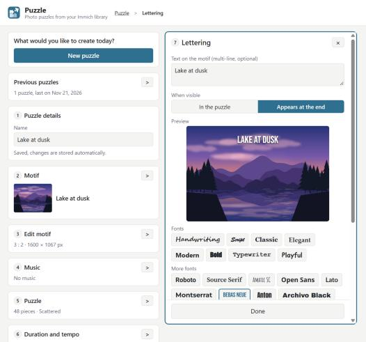

# Puzzle for Immich

**Puzzle** – Photo puzzles from your Immich library.


Pick a photo from your [Immich](https://immich.app) library (or upload one), choose a format and 24 to 500 pieces,
add music and a caption, and share a link. The recipient taps ▶ and watches the puzzle assemble itself live in the
browser, piece by piece, with music. The link stays small and sharp on every screen; an MP4 for download is
optional.

- Photo from Immich (albums, people, shared albums) or uploaded; nine formats, crop, rotate, zoom
- 24–500 pieces, round or classic piece shapes (straight edge pieces and corners), scattered or piled start,
  rotated pieces, frame first, speed curve
- Music from your own library or uploaded (MP3, M4A, OGG, WAV), fade-out, duration up to one minute
- Caption with 21 fonts, nine positions and colours; title and hold time at the end, then a zoom to full screen
- Shared links on a separate port, with password, photo and video download, metadata, validity period and an
  on/off switch
- Optional: MP4 video of a shared puzzle, rendered on your server without network access
- Optional: kiosk mode for guests without an account, phone notifications via ntfy
- English and German, light and dark



Changes: [CHANGELOG](app/CHANGELOG.md).

## Quick start (Docker Compose)

You need Docker with the Compose plugin. Immich is optional: without it, Puzzle works with uploaded photos only;
then skip step 1 and leave `IMMICH_URL` and `IMMICH_API_KEY` empty.

### 1. Create an Immich API key (optional)

In Immich: **Account settings → API keys → New API key**. Puzzle only reads from Immich. Either give the key all
permissions or at least these:

| Permission | Used for |
|---|---|
| `server.about` | Immich version on the About page |
| `user.read` | your own and shared albums |
| `album.read` | album list |
| `person.read` | people list |
| `asset.read` | photo search |
| `asset.view` | thumbnails and previews |
| `asset.download` | the full photo for the puzzle |

### 2. Get the files

```bash
mkdir immich-puzzle && cd immich-puzzle
```

```bash
curl -fsSLO https://raw.githubusercontent.com/rheckly/immich-puzzle/main/compose.yaml
```

```bash
curl -fsSL -o .env https://raw.githubusercontent.com/rheckly/immich-puzzle/main/.env.example
```

(Or clone the repository and copy `.env.example` to `.env`.)

### 3. Fill in `.env`

At least:

```ini
IMMICH_URL=http://192.0.2.10:2283      # your Immich server, as the container reaches it (empty: uploads only)
IMMICH_API_KEY=...                     # the key from step 1 (empty: uploads only)
LOGIN_PASSWORD=...                     # strongly recommended, see "Security"
```

`IMMICH_URL` must not be `localhost`: inside the container that is the container itself. Use the IP or name of the
host, or join the Immich network (see the comment in `compose.yaml`) and use `http://immich_server:2283`.

### 4. Start

```bash
docker compose up -d
```

Open `http://<your-host>:8080`. Puzzles, settings and uploaded music are stored in `./data`.

To update later: `docker compose pull && docker compose up -d`.

### Try it on your computer (Docker Desktop)

Four steps with Docker Desktop running. In Windows PowerShell write `curl.exe` (plain `curl` is something else
there); on macOS and Linux `curl`.

**1. Get the files**

```powershell
mkdir puzzle-test; cd puzzle-test
```

```powershell
curl.exe -fsSLO https://raw.githubusercontent.com/rheckly/immich-puzzle/main/compose.yaml
```

```powershell
curl.exe -fsSL -o .env https://raw.githubusercontent.com/rheckly/immich-puzzle/main/.env.example
```

**2. Adjust `.env` (optional)**

As it comes, `.env` runs with uploads only and without login. For your Immich fill in `IMMICH_URL` and
`IMMICH_API_KEY` (both, see step 3 above). To open shared puzzles straight from the app, set
`SHARE_PUBLIC_URL=http://localhost:8081/puzzles`. Busy port: change `PUZZLE_PORT` / `PUZZLE_SHARE_PORT`.

**3. Start**

```powershell
docker compose up -d
```

Docker pulls the image from ghcr.io. Open the app at `http://localhost:8080`. Shared puzzles play at
`http://localhost:8081` followed by the path of the link, e.g. `http://localhost:8081/puzzles/<code>/`.

**4. Remove it again**

```powershell
docker compose down
```

```powershell
docker rmi ghcr.io/rheckly/immich-puzzle:latest
```

Then delete the folder `puzzle-test` (it also holds `data` and `music`).

> [!WARNING]
> **Security: without `LOGIN_PASSWORD` the app is open.** Everybody who reaches port 8080 can browse your Immich
> albums, people and photos through Puzzle and create public links. Set `LOGIN_PASSWORD` (and `LOGIN_USER`) before
> you expose the app beyond your own computer. After 5 failed logins an IP is locked for 5 minutes.

## Reverse proxy and shared links

The container has two ports:

| Port | Serves | Expose |
|---|---|---|
| 8080 | the app (editor, API) | behind your reverse proxy, with login |
| 8081 | shared links only: `/puzzles/<code>/` and their images and music | publicly |

Port 8081 knows nothing but shared puzzles; every other path returns 404. A typical setup:

- `https://puzzle.example.com` → `http://<host>:8080`
- `https://links.example.com/puzzles/` → `http://<host>:8081` (a path on a links domain, or a whole domain of its own)

Set the public address of the links, so that the app shows and copies the right URL:

```ini
SHARE_PUBLIC_URL=https://links.example.com/puzzles
```

The path of this address (`/puzzles`) is the prefix of every link; without a path it is `/puzzles`. You can also
change the address later in the app under **Settings → Live links**.

Nginx example for the links (Nginx Proxy Manager: Advanced tab of the links host):

```nginx
location ^~ /puzzles/ {
    proxy_pass http://192.0.2.20:8081;
    proxy_set_header Host $host;
    proxy_set_header X-Real-IP $remote_addr;
    proxy_set_header X-Forwarded-For $proxy_add_x_forwarded_for;
    proxy_set_header X-Forwarded-Proto $scheme;
}
```

### `TRUSTED_PROXIES`

Behind a reverse proxy every request comes from the proxy's IP. Puzzle only believes `X-Real-IP` and
`X-Forwarded-For` from the addresses in `TRUSTED_PROXIES` (comma-separated, empty by default):

```ini
TRUSTED_PROXIES=192.0.2.30
```

Use the IP of the proxy **as the container sees it**: the proxy host's LAN IP, or, if the proxy runs in Docker on the
same host, the gateway of the Docker network (often `172.17.0.1` or `172.18.0.1`; check the container log or
`docker network inspect`). If it is not set behind a proxy, the login lockout counts all visitors as one IP: five wrong
passwords from anybody lock out everybody for five minutes. Never list addresses that clients can reach directly,
or they can fake their IP.

## Optional features

Everything below can be left empty; the feature is simply off.

### Music

Put a music library (MP3, M4A, OGG, WAV, one subfolder per playlist) into `./music`, or point `MUSIC_PATH` in `.env`
to an existing folder. It is mounted read-only. Music uploaded in the app is stored in `./data/music`.

### Login

`LOGIN_USER` (default `admin`), `LOGIN_PASSWORD`, `LOGIN_NAME` (display name in the profile). Without
`LOGIN_PASSWORD` there is no login at all (see "Security").

### Family (several Immich tools, one login)

Puzzle belongs to a small family of Immich tools by the same author. With a shared register they show each other under
**Something else** and share one login across subdomains:

- `FAMILY_SECRET`: the same random value (at least 16 characters) in every tool, e.g. `openssl rand -hex 32`
- `FAMILY_COOKIE_DOMAIN`: the parent domain of all tools, e.g. `.example.com`
- a register `family.json`, mounted at `/family/family.json` (uncomment the volumes in `compose.yaml`):

```json
[
  {"id": "puzzle", "name": "Puzzle", "url": "https://puzzle.example.com", "new_path": "/", "enabled": true},
  {"id": "collage", "name": "Collage", "url": "https://collage.example.com", "new_path": "/", "enabled": true}
]
```

`./family/state` (mounted at `/family-state`) lets all tools share the login lockout. If `family.json` lists no tool
other than Puzzle, the **Something else** button stays hidden. `SHARES_API_KEY` lets a hub service list the shared
links of all tools.

### Statistics (Umami)

With your own [Umami](https://umami.is) instance: `UMAMI_URL` and `UMAMI_WEBSITE_ID` count visits of the app,
`UMAMI_LINKS_ID` counts views of shared links (without the code in the URL). Empty: nothing is counted and no script
is loaded.

### Video download (MP4)

The `render` service in `compose.yaml` turns a shared puzzle into an MP4 (30 fps, 1920×1080 or 1080×1920 after
the photo, with title, footer and music). It uses the same puzzle engine as the browser (Node, Skia, ffmpeg, no
browser) and runs without any network: no port, no internet; it only exchanges files in `./data/render`.

- switch it on under **Settings › Video download › Create videos**; without the `render` service the switch has no effect
- a video is only made for an active link with **Allow download (video)**, one after another, about a minute
  after the last change; recipients see "Creating video …" until it is ready
- the video is deleted with the puzzle, when the link is deleted or the switch is turned off
- `RENDER_SIZE` sets the short side (default `1080`; `720` renders faster); the image is built for `linux/amd64`
- remove the `render` service from `compose.yaml` if you do not want videos

### Notifications (ntfy)

With your own [ntfy](https://ntfy.sh) server, Puzzle sends a daily summary of the previous day (new puzzles and
links, views, likes, storage) and a message when it starts after a crash; the kiosk also reports limits that
were reached and failed cleanup jobs. Set `NTFY_URL`, `NTFY_TOPIC` and `NTFY_TOKEN` (the token of a ntfy user
that may only write to this topic). Under **Settings** (kiosk: in the admin) each kind has its own switch, the
time of the summary (default 08:00), **Send test notification** and **Send summary now**. Messages contain no IP
addresses and no names of visitors. Without `NTFY_URL` nothing is sent.

### Kiosk mode

A second container from the same image lets guests make a puzzle from an uploaded photo without signing in, e.g. at
an event or on a public page. Use `compose.kiosk.yaml` in its own folder with its own `./data`:

- port 8080: guest editor (public), port 8081: shared links (public), port 8082: admin with login (the normal app plus
  a **Kiosk** box: on/off, numbers per day, cleanup job, contact address and text of the privacy page, default website title)
- no Immich, no shares API; guests cannot upload music (a read-only library in `/music` is offered if present)
- every guest puzzle gets an edit link; only a hash of its key is stored
- puzzles without a link are deleted after `KIOSK_DRAFT_HOURS`, puzzles with a link when it expires (7 days at most)
- `KIOSK_MAX_PHOTO_MB`, `KIOSK_MAX_PER_IP_HOUR` (new puzzles and photo changes; IPv6 counted per /64),
  `KIOSK_MAX_ACTIVE_PER_IP`, `KIOSK_MAX_PUZZLES`, `KIOSK_MAX_STORAGE_MB`, `KIOSK_DRAFT_HOURS`, `KIOSK_CLEAN_MINUTES`,
  `KIOSK_ENABLED` (start state), `ADMIN_PORT` (default 8082)
- photos above 40 megapixels or in other formats than JPEG, PNG and WebP are refused; the admin has an emergency stop
  that deletes all guest puzzles of the last hours
- `compose.kiosk.yaml` runs the container hardened (own user, read-only, no capabilities, memory/process/CPU limits);
  the guest editor and shared links send a strict Content Security Policy
- behind a reverse proxy set `TRUSTED_PROXIES`, otherwise all guests count as one device
- set **Made with** in the admin settings to the guest address: shared links then show "Make your own puzzle"
- guests make a puzzle in three steps: **Photo · Design · Share**
- `./data` must belong to `PUID`:`PGID` (default `1000:1000`); the kiosk keeps guest puzzles in `./data/kiosk`
- video download and ntfy work as described above; the switches are in the admin (port 8082). The `render`
  service in `compose.kiosk.yaml` runs as the same user as the kiosk, because the kiosk deletes the videos
- host ports: `KIOSK_PORT`, `KIOSK_SHARE_PORT`, `KIOSK_ADMIN_PORT` (default 8080, 8081, 8082); pin the image
  version for a public service

## All settings

| Variable | Default | Meaning |
|---|---|---|
| `IMMICH_URL` | – | Immich server; empty together with `IMMICH_API_KEY` = uploads only |
| `IMMICH_API_KEY` | – | Immich API key |
| `LOGIN_USER` / `LOGIN_PASSWORD` / `LOGIN_NAME` | `admin` / empty / empty | login; empty password = open |
| `SHARE_PUBLIC_URL` | empty | public base address of the shared links |
| `TRUSTED_PROXIES` | empty | IPs of reverse proxies whose `X-Real-IP` / `X-Forwarded-For` count |
| `PUZZLE_PORT` / `PUZZLE_SHARE_PORT` | `8080` / `8081` | host ports (compose only) |
| `MUSIC_PATH` | `./music` | host folder with music (compose only) |
| `TZ` | `UTC` | time zone |
| `FAMILY_ID` / `FAMILY_SECRET` / `FAMILY_COOKIE_DOMAIN` | `puzzle` / empty / empty | family login |
| `SHARES_API_KEY` | empty | key for the shared-links overview of a hub service |
| `UMAMI_URL` / `UMAMI_WEBSITE_ID` / `UMAMI_LINKS_ID` | empty | Umami statistics |
| `NTFY_URL` / `NTFY_TOPIC` / `NTFY_TOKEN` | empty | phone notifications via ntfy |
| `RENDER_SIZE` | `1080` | short side of the MP4 in pixels (render service) |
| `PUID` / `PGID` | `1000` / `1000` | user of the kiosk and its render service (compose.kiosk.yaml) |
| `KIOSK_PORT` / `KIOSK_SHARE_PORT` / `KIOSK_ADMIN_PORT` | `8080` / `8081` / `8082` | kiosk host ports (compose only) |
| `DATA_DIR` / `PUZZLE_DIR` / `MUSIC_DIR` | `/data` / `/data/puzzles` / `/music` | paths inside the container |

## Development

```bash
python -m venv .venv && .venv/bin/pip install -r app/requirements.txt
```

A fake Immich with coloured test photos, then the app against it:

```bash
.venv/bin/python tests/fake_immich.py 2299 200
```

```bash
cd app && IMMICH_URL=http://127.0.0.1:2299 IMMICH_API_KEY=test-key DATA_DIR=../data MUSIC_DIR=../data/music-lib SHARE_PORT=8081 SHARE_PUBLIC_URL=http://127.0.0.1:8081/puzzles ../.venv/bin/python server.py
```

Tests:

```bash
.venv/bin/python -m unittest discover -s tests && .venv/bin/python tests/check_texts.py
```

(On Windows `.venv/Scripts/python`.) Releases: every tag `vX.Y.Z` builds `ghcr.io/rheckly/immich-puzzle:X.Y.Z`,
`ghcr.io/rheckly/immich-puzzle-render:X.Y.Z` and `:latest`. The author's own NAS setup is described in German in
[docs/NAS.de.md](docs/NAS.de.md).

## License

Copyright © 2026 Happy PC – Roger Heckly

Licensed under the [GNU Affero General Public License v3.0](LICENSE). The fonts in `app/fonts/` keep their own
licenses (SIL Open Font License or Apache 2.0, the license file sits next to each font).

**How it was made.** Idea, concept, design and every decision by Roger Heckly. The code was written with AI
assistance (Claude Code) and reviewed and tested by the author.

**No warranty.** This software is provided "as is", without warranty of any kind (see sections 15 and 16 of the
license). You use it at your own risk. Puzzle only reads from Immich, but keep your own backups and protect the app
with a password before you expose it to the internet.

Puzzle is not affiliated with the Immich project.
